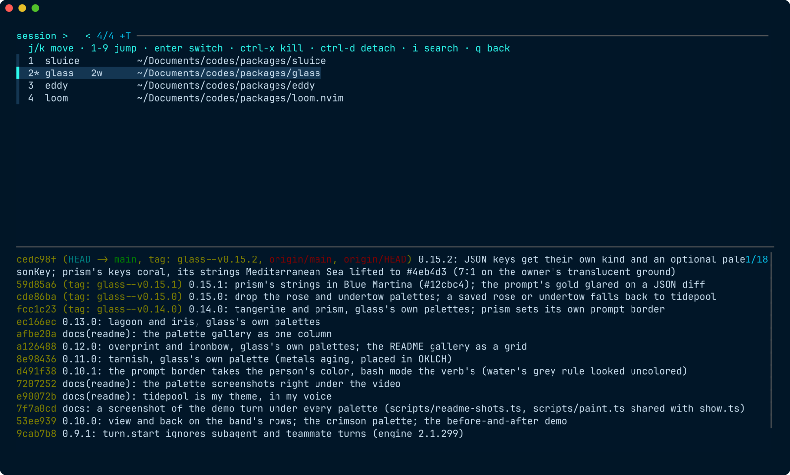

# sluice

tmux-style prefix keys and session switching on top of [zmx](https://github.com/neurosnap/zmx), with raw PTY passthrough.



I wanted to leave tmux without giving up the habits: `prefix+f` to pick a session, `prefix+1..9` to jump, `prefix+0` for the last one, a sessionizer on `prefix+s`, worktrees on `prefix+g`. tmux pays for those keys by parsing every byte of output into its own screen and re-emitting it. That is where images, the kitty keyboard protocol and clean truecolor get lost.

sluice does not touch output. zmx holds the shells and restores their screen on reattach. Ghostty (or any terminal) renders the real bytes. sluice sits only on the input side, reads the keyboard before forwarding it, and acts on the prefix. One blocked `poll(2)` when idle, one `read` and one `write` per chunk otherwise.

What this gives you compared to tmux:

- inline images, kitty keyboard protocol, OSC 52 clipboard, progress bars, truecolor, all native
- sessions that outlive the window, same as tmux, same as before
- the prefix keys, working even while nvim or an agent has the pane
- a clean keyboard in every session, even after one of them turned on the kitty keyboard protocol

Windows work like tmux's, without a tab bar: `prefix+c` opens one, `prefix+n` and `prefix+p` move between them, `prefix+w` lists them with what each one runs, and only the one you are on is drawn. A window fills the whole pane, so switching is the same raw-byte handoff as switching session and nothing is lost on the way.

What it does not do, by design: splits or a status line inside the terminal. Those need a screen model again. Use your terminal's splits, and put the session name in your prompt (`$ZMX_SESSION`).

## Install

```sh
brew install neurosnap/tap/zmx fzf
git clone https://github.com/rashedInt32/sluice && cd sluice
scripts/install.sh
```

That builds the binary into `~/.cargo/bin`, puts the pickers in `~/.config/sluice/bin`, and writes `~/.config/sluice/config` if you do not have one.

## Use

```sh
sluice main            # attach to "main", create it if needed
sluice glass -c ~/code/glass
sluice                 # fzf over live sessions; none? run the sessionizer
sluice list            # numbered sessions in jump order: index, name, clients, created, windows, cwd
sluice here            # the session named after this directory, created if needed
sluice keys            # the active bindings
```

Default keys, prefix `C-a`:

| key | action |
| --- | --- |
| `f` | pick a session: j/k move, 1-9 jump straight to a row, Enter switch, ctrl-x kill it, ctrl-d free it from the pane holding it, i or / to search, q or Esc back; preview of each screen |
| `s` | project picker over the directories in `project-dirs` |
| `g` | git worktree picker |
| `y` | launch, or go back to, the Claude session for this directory |
| `u` | every running Claude agent on the machine, and the session it is in |
| `c` | new window in this session, in the same directory |
| `n` / `p` | next / previous window of this session, wrapping |
| `w` | pick a window of this session: each row shows what it runs, 1-9 jump, Enter switch, ctrl-x kill that window, q or Esc back; preview of each screen |
| `1`..`9` | session by number, creation order |
| `0` | previous session |
| `d` | detach, session keeps running |
| `x` | kill this window (asks first), and the session with it if it was the last; in the picker, ctrl-x kills a whole session with no prompt |
| `?` | show bindings |
| `C-a` | send a real ctrl+a to the program |

In the session picker, `ctrl-x` kills the highlighted session outright and `ctrl-d` detaches whatever pane is holding it, so a session you left open elsewhere can be taken over. Both redraw the list in place. Killing the session the pane is showing is allowed: sluice then lands on the previous session, or on one nobody is watching.

Closing the window detaches. `exit` in the shell ends the session; sluice then moves to the previous session, or any live one, like tmux with `detach-on-destroy off`. Only when no session is left does sluice exit. Set `on-end close` in the config to exit at once instead.

zmx's own `ctrl+\` detach key is disabled inside sluice, so programs such as loom.nvim can use it. Detach with prefix+d, or from inside the session:

```sh
sluice detach          # detaches the sluice client showing this session
zmx detach             # zmx's own: detaches every client of the session
```

## Driving a pane from outside

`sluice switch` moves the pane that is showing a session, so a script or an editor can do what the prefix does:

```sh
sluice switch glass        # from inside a session
sluice switch -            # back to the previous one
sluice switch glass --session main   # name the pane's session explicitly
```

It reaches the client through a command file plus `SIGUSR1`, so it works from any process, including one running inside the session itself.

Exit codes: 0 after a detach or when the session ended, 3 when nothing was picked, 1 on error. The shell snippet below uses that to close the window on a clean exit and stay in the shell on a cancel.

## Config

`~/.config/sluice/config`:

```
prefix C-a
on-end previous                  # or close
bind f pick
bind s run ~/.config/sluice/bin/sessionizer
bind j run printf 'main\n'       # any command printing "name" or "name<TAB>dir"
unbind x
sessionizer ~/bin/my-projects    # what bare `sluice` runs with no sessions; defaults to the `s` command
title on                         # the window title is the session name; see below
```

As in tmux, pressing the prefix twice sends the prefix key itself. So a prefix on a key that has a default binding (`prefix d`) takes that key's place; sluice warns at start and in `sluice keys` when that leaves an action with no key.

`run` commands get the tty, so they can use fzf themselves. They print the session to attach, and optionally the directory to create it in.

The project picker and the sessionizer read their directories from `~/.config/sluice/bin/project-dirs`. Edit `ROOTS` at the top of it for your own layout; reinstalling never overwrites it.

## Claude agents

`prefix+y` starts a Claude session for the directory you are in, named after
it. Press it again from anywhere and you land back in the same agent rather
than starting a second one.

`prefix+u` lists every Claude running on the machine with its status, how long
since it last moved, and the session it lives in. Enter jumps there, ctrl-x
kills the agent, and the preview shows that session's screen. An agent running
inside nvim appears like any other: it inherits `ZMX_SESSION` from the session
hosting the editor, so jumping to it lands on that pane.

Both are ordinary `run` scripts in `~/.config/sluice/bin`, so they can be
replaced or rebound. A `run` script prints one line:

```
name                  attach to this session
name <TAB> dir        create it in dir if it is not running
name <TAB> dir <TAB> cmd   create it running cmd
```

The command is used only when the session has to be created, which is what
makes `prefix+y` both "launch" and "go back".

## Windows

A session is a group of zmx shells, one per window. Window 1 keeps the bare session name, so every session from before windows existed is just a one-window session. Window k is `<session>+<k>`.

- The session picker lists sessions, not windows, with a count when there are several, and what each window runs, in order: `zsh · nvim · claude✻`.
- `prefix+w` lists the windows of the session you are in, numbered in the order `prefix+n` walks them, with each one's command and screen. `prefix w 3` is the third window in two keys. That is its place in the list, not the `+3` in its name: after a kill the names leave gaps and the rows do not. A Claude agent shows its state and how long it has had it: `✻ waiting 2m`.
- Going back to a session lands on the window you last had open there.
- `exit` in a window, or `prefix+x`, moves to a neighbouring window of the same session before falling back to another session.
- `prefix+0` still means the previous *session*; moving between windows does not change it.
- `$ZMX_SESSION` inside a window is its own name, `glass+2`, which is handy in a prompt.

```sh
sluice list              # sessions, windows folded in
sluice list --windows    # every window
sluice list --rows --windows --current glass   # glass's windows, as prefix+w draws them
sluice switch glass+2    # one window explicitly; `glass+1` is window 1
sluice kill glass        # a session and all its windows
```

What a window runs is the foreground program of its terminal: the shell at its prompt, or the job it started. sluice reads it from the kernel when a picker opens, which takes microseconds and starts no process. A program inside another one, an agent in an nvim terminal say, shows as the outer one. A Claude agent's state comes from `~/.claude/sessions/<pid>.json`, the file `prefix+u` reads too.

## Sharing the prefix with a program

A program inside a session can ask for the prefix key itself, the way tmux's `@loom` pane option let loom.nvim take `C-a`:

```sh
sluice handoff on            # from inside the session; pid defaults to the caller
sluice handoff off
sluice handoff status
```

While the marker is on and its pid is alive, sluice forwards every key untouched. A dead pid ends the handoff by itself, so a crashed program cannot leave the prefix stuck. loom.nvim does this automatically when `sluice = true`.

## Whole sequences only

The scanner consumes complete input sequences. A sequence split across two reads is held until the rest arrives; if nothing follows within 50 ms it was typed (legacy alt+[ or alt+] send just `ESC [` / `ESC ]`) and goes through as it came. Anything that is not a key press (a key release report, a focus change, a mouse report) is forwarded intact rather than picked apart. Getting this wrong leaks the tail of an escape sequence into the program as literal text: a release report shredded that way reaches Neovim as `97;5:3u`, whose `:` opens the command line and whose digits land in it.

## Keyboard modes between sessions

zmx replays mouse, paste, alternate screen and modifyOtherKeys when a client reattaches, but not the kitty keyboard protocol flags. Left alone, a Ghostty that was showing nvim or Claude keeps sending CSI u encoded keys to the next thing: fzf in the picker, or a plain zsh in the session you jump to, where ctrl+p and ctrl+n turn into garbage.

sluice reads the output it forwards for the few sequences that change that state, keeps the result per session, puts the terminal's keyboard in a neutral state between sessions, and re-applies a session's flags when it comes back. Sessions this sluice has never shown start neutral; a program that enabled the protocol there will need to re-assert it, which is also what zmx does today.

## Shell integration

Replace the tmux auto-attach in `.zshrc` with this. No name means the session picker; Esc there means the project picker; Esc again leaves you in the plain shell. A clean exit, a detach or the session ending, closes the window like tmux did.

```zsh
if command -v sluice >/dev/null 2>&1; then
  if [ -z "$ZMX_SESSION" ] && [ -z "$TMUX" ] && [ -z "$NO_AUTO_SLUICE" ] && [ -t 0 ] && [ -t 1 ]; then
    if [ "$TERM_PROGRAM" = "ghostty" ] || [ -n "$GHOSTTY_RESOURCES_DIR" ]; then
      sluice && exit
    fi
  fi
fi
```

Every new Ghostty split or tab then starts in the picker.

Session name in the window title, like tmux's status line: put `title on` in the config. sluice sets the title to the session on every switch and drops the titles programs inside set (zsh, nvim, Claude), so they cannot overwrite it. The directory report (OSC 7) still passes, so Ghostty keeps its folder icon beside the name. Ghostty ignores titles while its own `title = ...` option is set, so remove that line. The default, `title off`, leaves output byte-for-byte untouched.

Session name in the prompt:

```zsh
[[ -n $ZMX_SESSION ]] && PROMPT="[$ZMX_SESSION] $PROMPT"
```

A mark like `◆2/3` while the session has more than one window. This reads zmx's socket directory with one glob, so it costs about 35µs per prompt and starts no process:

```zsh
_sluice_windows_mark() {
  unset SLUICE_WINDOWS
  [[ -n $ZMX_SESSION ]] || return 0
  local dir=${ZMX_DIR:-${XDG_RUNTIME_DIR:+$XDG_RUNTIME_DIR/zmx}}
  [[ -n $dir ]] || dir=${${TMPDIR:-/tmp}%/}/zmx-$UID
  local group=$ZMX_SESSION cur=1
  if [[ $ZMX_SESSION == ?*+<-> ]]; then group=${ZMX_SESSION%+*}; cur=${ZMX_SESSION##*+}; fi
  local -a ks socks; local s
  [[ -S $dir/$group ]] && ks+=(1)
  socks=( $dir/${(b)group}+<->(N=) )
  for s in $socks; do ks+=(${s##*+}); done
  (( ${#ks} > 1 )) || return 0
  ks=(${(on)ks})
  export SLUICE_WINDOWS="${ks[(Ie)$cur]}/${#ks}"
}
autoload -Uz add-zsh-hook && add-zsh-hook precmd _sluice_windows_mark
```

Show it with Starship's `env_var` module, which renders nothing while the variable is unset:

```toml
[env_var.SLUICE_WINDOWS]
format = "[ ◆$env_value]($style)"
```

## How it works

```
keyboard ──> sluice ──> zmx attach ──> zmx daemon ──> shell / nvim / claude
terminal <────────────────────────────────────────── raw bytes, untouched
```

`sluice` forks `zmx attach <name>` on a pty it owns. Output is copied to the terminal as is. Input is scanned for the prefix in its three possible encodings (legacy byte, kitty `CSI u`, xterm modifyOtherKeys). A chord detaches the client with SIGHUP, hands the tty to fzf or a picker script in cooked mode, then attaches the chosen session. zmx repaints the screen from its own terminal state, so switching looks like tmux.

## Tests

```sh
cargo test        # unit tests plus live tests against the real zmx daemon
```

The live tests spawn sluice under a pty with `SHELL=/bin/sh`, type into it, and check `zmx list`.

## Credits

The daemon is zmx by Eric Bower. The idea of a prefix layer without a screen model came from watching Rex and Tern put the daemon in a native app.
